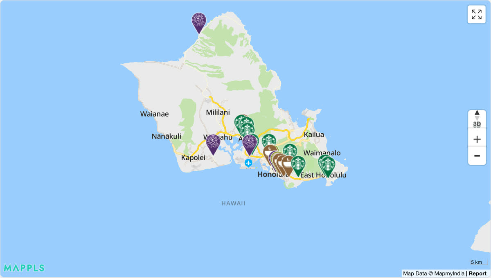

# @mapconductor/react-for-mappls

Mappls provider for the MapConductor React SDK. Renders a
[Mappls](https://map.mappls.com/) (Mappls API3, which uses MapLibre GL JS
internally) through MapConductor's provider-independent camera, marker, and
overlay API, so the same application code can also run on Google Maps, MapLibre,
Mapbox, MapTiler, Leaflet, OpenLayers, ArcGIS, Cesium, HERE, or TomTom.

## Demo

[](https://demo-react.mapconductor.com/mappls/map/en)

Open it in the [live demo](https://demo-react.mapconductor.com/mappls/map/en): the same store map runs on every provider, and the page switches between them. The code, cut down to three stores:

```tsx
import { useMemo, useState } from 'react';
import {
  createGeoPoint,
  createMapCameraPosition,
  createMarkerState,
  type MarkerState,
} from '@mapconductor/js-sdk-core';
import { InfoBubble, Markers } from '@mapconductor/js-sdk-react';
import { MapplsDesign, MapplsMapView2D, useMapplsViewState } from '@mapconductor/react-for-mappls';

const STORES = [
  { id: 'waikiki', name: 'Waikiki', latitude: 21.2793, longitude: -157.8292 },
  { id: 'kailua', name: 'Kailua', latitude: 21.3972, longitude: -157.7394 },
  { id: 'haleiwa', name: 'Haleiwa', latitude: 21.5928, longitude: -158.1034 },
];

const INITIAL_CAMERA = createMapCameraPosition({
  position: createGeoPoint({ latitude: 21.38, longitude: -157.93 }),
  zoom: 10,
});

export default function App() {
  const mapViewState = useMapplsViewState({
    apiKey: 'YOUR_MAPPLS_API_KEY',
    mapDesignType: MapplsDesign.Default,
    cameraPosition: INITIAL_CAMERA,
  });
  const [selected, setSelected] = useState<MarkerState | null>(null);
  const markers = useMemo(
    () =>
      STORES.map(store =>
        createMarkerState({
          id: store.id,
          position: createGeoPoint({ latitude: store.latitude, longitude: store.longitude }),
          extra: store,
          onClick: marker => setSelected(marker),
        }),
      ),
    [],
  );

  return (
    <div style={{ width: '100%', height: '100vh' }}>
      <MapplsMapView2D state={mapViewState} onMapClick={() => setSelected(null)}>
        <Markers states={markers} />
        {selected && (
          <InfoBubble marker={selected}>
            <strong>{(selected.extra as (typeof STORES)[number]).name}</strong>
          </InfoBubble>
        )}
      </MapplsMapView2D>
    </div>
  );
}
```

Replace `YOUR_MAPPLS_API_KEY` with your own key.

## Installation

```shell
npm install @mapconductor/react-for-mappls @mapconductor/js-sdk-core @mapconductor/js-sdk-react
```

The Mappls API3 script (which bundles MapLibre GL JS and its Web Worker) is
loaded from `apis.mappls.com` on demand — you do **not** need to install or
configure `maplibre-gl` yourself, and there is no stylesheet to import.

## API key

Mappls requires a [Mappls API key](https://map.mappls.com/console/) that
is authorized for the **web origin** your app is served from (unlike the mobile
SDKs, which authenticate with credential files bound to the app identifier).
Pass it to the view state:

```tsx
const state = useMapplsViewState({
  apiKey: MAPPLS_API_KEY,
  mapDesignType: MapplsDesign.Default,
  cameraPosition,
});
```

## Usage

```tsx
import {
  MapplsDesign,
  MapplsMapView2D,
  useMapplsViewState,
} from '@mapconductor/react-for-mappls';
import { createGeoPoint, createMapCameraPosition } from '@mapconductor/js-sdk-core';

// Your own key. Read it from your environment however your build tool does
// it, and keep it out of source control.
const MAPPLS_API_KEY = '…';

function Map() {
  const state = useMapplsViewState({
    apiKey: MAPPLS_API_KEY,
    mapDesignType: MapplsDesign.Default,
    cameraPosition: createMapCameraPosition({
      position: createGeoPoint({ latitude: 28.6139, longitude: 77.209 }), // New Delhi
      zoom: 11,
    }),
  });

  return <MapplsMapView2D state={state} />;
}
```

## Map designs

Which tiles you can use is **decided by your Mappls contract**, not by a fixed
catalogue. `MapplsDesign` ships four presets:

- `MapplsDesign.Default` — leaves the account's default style untouched
- `MapplsDesign.StandardDay` — the `standard_day` style; included in every contract
- `MapplsDesign.StandardNight` — the `standard_night` style; **paid add-on**
- `MapplsDesign.GreyDay` — the `grey_day` style; **paid add-on**

The two add-on styles are only usable once your contract includes them; without
them the SDK rejects the name. This repository's sample apps do not pay for the
add-ons, so they list only `Default` and `StandardDay`.

Any other style your Mappls account has been assigned can be selected with
`new MapplsDesign(id, styleName)`; the SDK rejects names the account does not
have, and the available names can be listed at runtime with
`mapplsClassObject.getStyles()`. Switch design by updating the view state's
`mapDesignType` — it is applied through `mappls.setStyle()`.

## How it works

Mappls API3 boots through the vendor wrapper (`mappls.Map`) — which is also
where the account style is applied — and then resolves the underlying MapLibre
GL JS map behind it. Camera control, map events, and all overlays (markers,
polylines, polygons, circles, ground images, raster layers) are driven directly
on that GL map, the same MapLibre-based renderer architecture used by the other
MapConductor MapLibre-family providers. Mappls API3 renders in mercator only,
so `MapplsMapView` and `MapplsMapView2D` are the same 2D view — the former
exists for naming symmetry with the other providers.

## License

Apache-2.0
